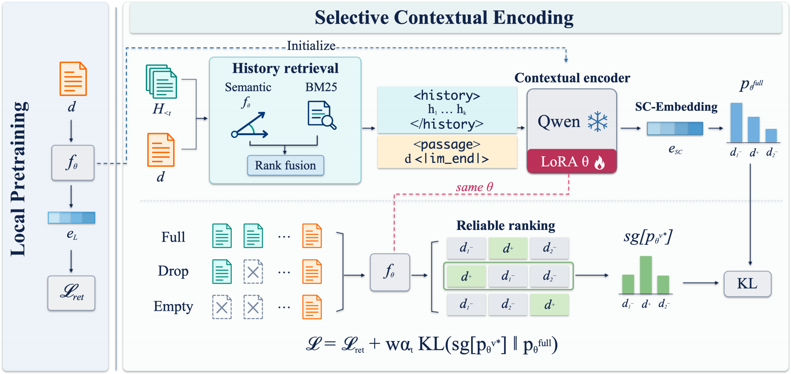

<div align="center">

# SC-Embedding
### Retrieval Augmented Selective Contextualization<br>for Long-Context Retrieval

[](https://github.com/yulinlp/SC-Embedding)
[](#installation)
[](#installation)
[](LICENSE)

**[English](README.md) | [中文](README_zh.md)**

[方法概览](#overview) · [模型](#models) · [快速使用](#quick-start) · [训练](#training)

</div>

**SC-Embedding** 包含 0.8B、2B 和 4B 三个尺寸的上下文化嵌入模型，在**访问哪些历史**和**如何利用历史学习表示**两个层面引入选择性。

<a id="overview"></a>

## 💡 方法概览

段落的含义往往依赖文档或对话中更早的信息，但相关的历史并不一定有助于当前段落的表示。SC-Embedding 从两个层面实现选择性上下文化：

- **选择性检索。** 结合语义相似度与 BM25 检索当前段落之前的相关历史，保留历史原文和时间顺序，并通过显式边界区分历史与当前段落。
- **选择性上下文学习。** 比较完整历史、丢弃部分历史和空历史下的检索排序，以可靠且能改善检索的视图提供自蒸馏目标，通过渐进加权和梯度校准控制监督强度。

<p align="center">
  
</p>

同一个 LoRA 编码器用于历史检索、问题编码和上下文化段落编码。输出为归一化的稠密向量，可接入常规相似度搜索和检索流程。

<a id="models"></a>

## 📦 模型

| 模型 | 基座 | 已选定适配器大小 |
| :--- | :--- | :--- |
| [SC-Embedding-0.8B](https://huggingface.co/linlp22/SC-Embedding-0.8B) | [Qwen3.5-0.8B](https://huggingface.co/Qwen/Qwen3.5-0.8B) | 165 MiB |
| [SC-Embedding-2B](https://huggingface.co/linlp22/SC-Embedding-2B) | [Qwen3.5-2B](https://huggingface.co/Qwen/Qwen3.5-2B) | 257 MiB |
| [SC-Embedding-4B](https://huggingface.co/linlp22/SC-Embedding-4B) | [Qwen3-4B-Instruct-2507](https://huggingface.co/Qwen/Qwen3-4B-Instruct-2507) | 504 MiB |

点击上表中的模型名称即可下载选定的 LoRA 适配器。[模型元数据](checkpoints.json)记录了基座模型、Hub 版本和 SHA-256 校验值。基座权重需单独准备。

<details>
<summary><b>权重来源说明</b></summary>

本次选定的现有适配器保留其原始的固定初始教师训练来源；仓库训练入口实现最终的在线跨视图自蒸馏算法。导出的适配器张量保持不变，不将其标记为该训练入口的产物。

</details>

<a id="installation"></a>

## 🔧 安装

请先安装适配加速设备的 PyTorch。Ascend 环境还需匹配的 `torch_npu` 和 CANN。

```bash
git clone https://github.com/yulinlp/SC-Embedding.git
cd SC-Embedding
python -m pip install -e '.[test]'
```

开发环境为 PyTorch 2.9.0、Transformers 5.8.1、PEFT 0.14.0、torch-npu 2.9.0.post2 和 CANN 9.0.0。论文训练使用一台配备八张 Ascend 910B NPU 的服务器。

<a id="quick-start"></a>

## 🚀 快速使用

下载适配器及其基座，然后从本地加载：

```bash
hf download linlp22/SC-Embedding-4B --local-dir checkpoints/SC-Embedding-4B
hf download Qwen/Qwen3-4B-Instruct-2507 --local-dir models/Qwen3-4B-Instruct-2507
```

```python
import torch
import torch_npu
from sc_embedding.model import SCEmbedding

torch.npu.set_device(0)
model = SCEmbedding.from_pretrained(
    "models/Qwen3-4B-Instruct-2507",
    adapter="checkpoints/SC-Embedding-4B",
    device="npu:0",
)

passages = [
    "Alice moved to Paris.",
    "She now works at the city hospital.",
]
documents = model.encode_passages(passages)
queries = model.encode_queries(["Where does Alice work?"])
scores = queries @ documents.T
```

每次 `encode_passages` 调用接收**同一篇文档或同一段对话中按顺序排列的段落**。问题独立编码；没有历史上下文时使用 `model.encode_passages(passages, contextual=False)`。

使用 CUDA 时，将设备改为 `device="cuda:0"`，并移除 Ascend 的导入和设备选择。文件形式的推理入口见 [scripts/encode.py](scripts/encode.py)。

<a id="training"></a>

## 🧪 训练

### 1. 准备基座和数据

准备相应的 Qwen 基座，以及 [EvoTrain-180K](https://huggingface.co/datasets/MiG-NJU/EvoTrain-180K) 的原始 `data_chunk_*.json` 文件。训练使用有序的原始对话轮次和检索相关性标签；启动脚本仅读取本地文件，模型和数据需另行下载。

自定义数据可采用以下 JSONL 格式：

```json
{"id":"example-1","passages":["Alice lives in Paris.","Bob lives in London."],"query":"Where does Alice live?","positives":[0]}
```

正例下标从 0 开始。每条样本至少包含一个正例和一个负例。最终问题和标签不参与历史检索。

### 2. 一条命令串联两个阶段

```bash
MODEL_SIZE=4B DEVICE=npu NPROC=8 bash scripts/train.sh \
  --base-model /path/to/Qwen3-4B-Instruct-2507 \
  --data /path/to/EvoTrain-180K \
  --output runs/sc-4b
```

其他尺寸使用 `MODEL_SIZE=0.8B` 或 `MODEL_SIZE=2B`，并指定相应基座。`DEVICE=cuda` 用于 NVIDIA GPU；有效 batch size 为 16。

训练在内存中的同一个模型上依次完成 **Local 预训练 → 选择性上下文学习**。阶段切换时保留已学权重并重置 AdamW，**不保存或重新加载一阶段 checkpoint**，只在 `runs/sc-4b/final/` 保存最终适配器。

| 设置 | 0.8B | 2B | 4B |
| :--- | ---: | ---: | ---: |
| Local 学习率 | 5e-5 | 5e-5 | 5e-5 |
| Contextual 学习率 | 5e-6 | 2e-5 | 1e-5 |
| LoRA rank / alpha | 64 / 128 | 64 / 128 | 64 / 128 |
| 历史 top-k / token 预算 | 4 / 2048 | 4 / 2048 | 4 / 2048 |

完整超参数和训练长度见 [configs/](configs/)。`--local-steps` 和 `--contextual-steps` 可修改停止步数，而不改变学习率调度周期。数据筛选、可选训练子集、优化和保存行为见[训练说明](docs/TRAINING.md)。

### 3. 验证安装

```bash
pytest -q
```

八项 CPU 测试覆盖因果检索、历史视图、蒸馏、梯度缓存、Qwen3/Qwen3.5 attention 和两阶段训练；双进程 CPU 训练启动及最终适配器重载也已通过。这些为小模型验证，整理后的独立代码尚未重跑完整八卡 NPU 或 CUDA 训练，详见[验证记录](VALIDATION.md)。

## 📁 目录结构

```text
assets/          方法图
configs/         0.8B、2B、4B 训练配置
sc_embedding/    编码器、历史检索、损失与两阶段训练
scripts/         训练及推理入口
tests/           核心功能与小模型集成测试
checkpoints.json 选定适配器的标识和校验值
```

## 致谢

训练设置建立在 EvoEmbedding 和 [EvoTrain-180K](https://huggingface.co/datasets/MiG-NJU/EvoTrain-180K) 的基础上。感谢 [Qwen](https://github.com/QwenLM)、[Transformers](https://github.com/huggingface/transformers) 和 [PEFT](https://github.com/huggingface/peft) 的作者。

## 许可证

项目代码采用 [Apache-2.0](LICENSE)。第三方模型和数据集遵循各自许可证，参见 [NOTICE](NOTICE)。
