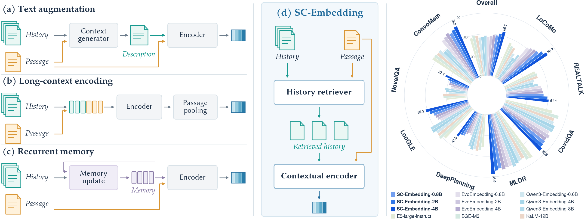

<div align="center">

# SC-Embedding
### Retrieval Augmented Selective Contextualization<br>for Long-Context Retrieval

[](#models)
[](https://github.com/yulinlp/SC-Embedding)
[](LICENSE)

**[English](README.md) | [中文](README_zh.md)**

[方法概览](#overview) · [实验结果](#results) · [模型下载](#models) · [推理](#inference) · [训练](#training)

</div>

**SC-Embedding 在两个层面实现选择性上下文化：访问哪些历史，以及从哪些信息中学习。** 我们提供 **0.8B、2B 和 4B** 三个尺寸的上下文化嵌入模型，用于长文档检索、对话搜索和智能体记忆。

<p align="center">
  
</p>

<a id="overview"></a>

## 方法概览

长文档和对话中的段落常常依赖前文信息。现有上下文化嵌入方法通过生成描述、连续文本窗口或递归隐状态记忆获取上下文，但这些方式可能损失历史细节，也可能纳入对当前段落表示无益的信息。

SC-Embedding 引入两个层面的选择：

- **选择性检索：** 结合语义相似度与 BM25，检索相关历史段落的原文，并保留其时间顺序。
- **选择性上下文学习：** 比较完整历史、部分历史丢弃和空历史下的检索排序，通过自蒸馏，从能够可靠改善检索的视图中学习。

训练先进行 **Local 预训练**，再通过**选择性上下文学习**形成上下文化表示。同一个编码器提供独立表示和上下文化表示，问题独立编码，输出的归一化向量可直接用于常规向量检索。

<details>
<summary><b>训练框架</b></summary>

<p align="center">
  
</p>

</details>

<a id="results"></a>

## 实验结果

使用与 EvoEmbedding 相同来源的 EvoTrain-180K 中 **116K 条带检索标签的样本**，SC-Embedding 在三个模型尺寸上均提升了检索性能。**SC-Embedding-4B 的 nDCG@10 比 EvoEmbedding-4B 高 7.49 个百分点**，同时超过参数量更大的 KaLM-12B。

**检索任务。** 下表为 LoCoMo、REALTALK、CovidQA、MLDR、DeepPlanning、LooGLE、NovelQA 和 ConvoMem 八项基准的宏平均。分数为百分数，Recall@10 遵循 LMEB 的 capped-recall 定义。

| 模型 | 参数量 | Recall@10 | nDCG@10 |
| :--- | ---: | ---: | ---: |
| Qwen3-Embedding-8B | 8B | 69.84 | 57.48 |
| KaLM-Gemma3-12B | 12B | 72.29 | 57.94 |
| EvoEmbedding-0.8B | 0.8B | 69.71 | 55.63 |
| EvoEmbedding-2B | 2B | 71.04 | 57.01 |
| EvoEmbedding-4B | 4B | 72.20 | 58.65 |
| **SC-Embedding-0.8B** | **0.8B** | **72.31** | **59.03** |
| **SC-Embedding-2B** | **2B** | **75.33** | **62.23** |
| **SC-Embedding-4B** | **4B** | **78.17** | **66.14** |

**下游生成。** SC-Embedding-4B 在五项任务上取得最高平均准确率，在其中四项领先，平均比 EvoEmbedding-4B 高 **1.78 个百分点**。

| 模型 | LoCoMo | LongMemEval-s | PersonaMem-32K | PMME-32K | PMME-128K | 平均 |
| :--- | ---: | ---: | ---: | ---: | ---: | ---: |
| KaLM-Gemma3-12B | 62.99 | 71.60 | 56.88 | 72.17 | 72.81 | 67.29 |
| EvoEmbedding-4B | 64.48 | 74.20 | 55.35 | **72.68** | 73.60 | 68.06 |
| **SC-Embedding-4B** | **67.92** | **75.80** | **57.56** | 72.42 | **75.49** | **69.84** |

在 Mem0、A-MEM、LightMem 和 MemoryOS 中，将 MiniLM 替换为 SC-Embedding，还能使 LoCoMo 生成准确率提升 **6.75–8.72 个百分点**。以上为论文报告的结果。

<a id="models"></a>

## 模型下载

| 模型 | 基座 | LoRA 下载 |
| :--- | :--- | :--- |
| SC-Embedding-0.8B | [Qwen3.5-0.8B](https://huggingface.co/Qwen/Qwen3.5-0.8B) | [🤗 165 MiB](https://huggingface.co/linlp22/SC-Embedding-0.8B) |
| SC-Embedding-2B | [Qwen3.5-2B](https://huggingface.co/Qwen/Qwen3.5-2B) | [🤗 257 MiB](https://huggingface.co/linlp22/SC-Embedding-2B) |
| SC-Embedding-4B | [Qwen3-4B-Instruct-2507](https://huggingface.co/Qwen/Qwen3-4B-Instruct-2507) | [🤗 504 MiB](https://huggingface.co/linlp22/SC-Embedding-4B) |

请同时下载适配器和对应基座。已发布适配器使用固定初始教师训练，本仓库的训练方案采用在线自蒸馏；具体来源见模型卡和[模型元数据](checkpoints.json)。

## 安装

先安装适配加速设备的 PyTorch，再安装本项目：

```bash
git clone https://github.com/yulinlp/SC-Embedding.git
cd SC-Embedding
pip install -e .
```

开发环境使用 Python 3.11、PyTorch 2.9.0、Transformers 5.8.1 和 PEFT 0.14.0。Ascend 还使用 torch-npu 2.9.0.post2 和 CANN 9.0.0。代码包含 CUDA 入口，但尚未完成完整 CUDA 训练验证。

<a id="inference"></a>

## 推理

下载 checkpoint 和基座：

```bash
hf download linlp22/SC-Embedding-4B --local-dir checkpoints/SC-Embedding-4B
hf download Qwen/Qwen3-4B-Instruct-2507 --local-dir models/Qwen3-4B-Instruct-2507
```

编码有序段落与独立问题：

```python
from sc_embedding import SCEmbedding

model = SCEmbedding.from_pretrained(
    "models/Qwen3-4B-Instruct-2507",
    adapter="checkpoints/SC-Embedding-4B",
    device="cuda:0",
)

passages = [
    "Alice moved to Paris.",
    "She now works at the city hospital.",
]
documents = model.encode_passages(passages)
queries = model.encode_queries(["Where does Alice work?"])
scores = queries @ documents.T
print(scores)
```

Ascend 环境需导入 `torch` 和 `torch_npu`，调用 `torch.npu.set_device(0)`，并将设备改为 `device="npu:0"`。

每个段落列表必须来自**同一篇文档或同一段对话，并按时间顺序排列**，历史检索只访问当前段落之前的内容。独立文本编码使用 `model.encode_passages(passages, contextual=False)`。默认历史预算为四个段落、2,048 tokens。

<a id="training"></a>

## 训练

使用 [EvoTrain-180K](https://huggingface.co/datasets/MiG-NJU/EvoTrain-180K) 的原始 `data_chunk_*.json` 文件，或包含有序段落、问题和正例下标的 JSONL 文件。下标从 0 开始：

```json
{"id":"example-1","passages":["Alice lives in Paris.","She works as a doctor.","Bob lives in London."],"query":"Where does Alice live?","positives":[0]}
```

每条样本至少包含一个正例和一个负例。问题与相关性标签提供训练监督，历史检索只使用段落文本。

**一条命令完成两个阶段，并保存最终适配器：**

```bash
MODEL_SIZE=4B DEVICE=npu NPROC=8 bash scripts/train.sh \
  --base-model models/Qwen3-4B-Instruct-2507 \
  --data /path/to/EvoTrain-180K \
  --output runs/sc-4b
```

Local 预训练和选择性上下文学习之间直接保留模型权重，只在 `runs/sc-4b/final/` 保存最终结果，无需中间 Local checkpoint。训练完成后，使用上面的推理代码加载该目录即可。

| 设置 | 0.8B | 2B | 4B |
| :--- | ---: | ---: | ---: |
| Local 学习率 | 5e-5 | 5e-5 | 5e-5 |
| Contextual 学习率 | 5e-6 | 2e-5 | 1e-5 |
| LoRA rank / alpha | 64 / 128 | 64 / 128 | 64 / 128 |

其他尺寸设置 `MODEL_SIZE=0.8B` 或 `MODEL_SIZE=2B`，并提供对应基座。NVIDIA GPU 使用 `DEVICE=cuda`。`NPROC` 必须能整除有效 batch size 16。超参数见 [configs/](configs/)；`--local-steps` 和 `--contextual-steps` 可修改停止步数，同时保留配置中的学习率调度。论文训练使用一台配备八张 Ascend 910B NPU 的服务器。

## 致谢与许可证

本项目建立在 EvoEmbedding / [EvoTrain-180K](https://huggingface.co/datasets/MiG-NJU/EvoTrain-180K)、[Qwen](https://github.com/QwenLM)、[Transformers](https://github.com/huggingface/transformers) 和 [PEFT](https://github.com/huggingface/peft) 的基础上。代码采用 [Apache-2.0](LICENSE)，第三方模型和数据遵循各自许可证，详见 [NOTICE](NOTICE)。
